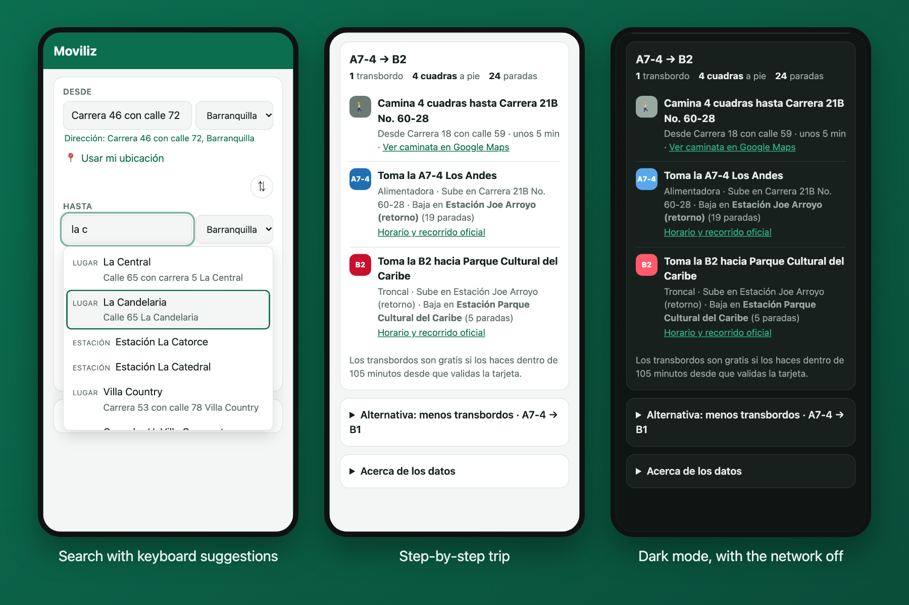

# Moviliz

[](https://github.com/ycantill/moviliz/actions/workflows/ci.yml)
[](https://github.com/ycantill/moviliz/actions/workflows/pages.yml)
[](https://ycantill.github.io/moviliz/)




> **English:** an offline-first PWA that plans bus trips on Barranquilla's Transmetro BRT system, entirely on the device. See the [technical overview](#technical-overview) below.

App web (PWA) para planear viajes en **Transmetro Barranquilla** sin conexión.
Escribes un origen y un destino (dirección, estación o paradero) y la app
te dice qué rutas tomar, dónde subir, dónde bajar y cuánto caminar.

El buscador acepta solo puntos exactos: direcciones ("Cra 43 # 70-15"),
estaciones y paraderos con nombre. No incluye barrios (un barrio no es un punto
y daba rutas equivocadas) ni busca nombres de lugares en internet.

- **Funciona offline.** La primera vez que abres la app se guardan la app y la base de rutas en el teléfono (service worker + IndexedDB). Después ya no necesita internet.
- **El cálculo se hace en el dispositivo.** No hay servidor ni modelo de lenguaje: es un buscador de caminos (Dijkstra) sobre la red de estaciones y paraderos.
- **Dos perfiles:** *Caminar menos* (por defecto) y *Menos transbordos*. Si el otro perfil da una ruta distinta, se muestra como alternativa.
- **Caminatas en Google Maps.** Cada tramo a pie trae un enlace para verlo en Google Maps.
- **Origen por ubicación.** El botón "Usar mi ubicación" toma el GPS del celular (funciona sin internet) y lo convierte en la esquina más cercana usando 1.111 esquinas de calles y carreras de OpenStreetMap (`data/raw/anclas.txt`), con un error típico de media cuadra. La ubicación no sale del celular. Fuera de las calles numeradas de Barranquilla, Soledad y Malambo no se puede usar.
- **Recientes.** Los últimos 4 viajes completos buscados (origen y destino juntos, no lugares sueltos); un toque repite la búsqueda con la hora actual. Se guardan solo en tu navegador (localStorage) y se pueden borrar. Un viaje que sale de la ubicación del GPS no se guarda.

## Datos

La base sale del sitio oficial de Transmetro (transmetro.gov.co): 17 estaciones,
12 rutas troncales y 28 alimentadoras, con sus paraderos, barrios y horarios.

- `data/raw/rutas_transmetro.json`: base de conocimiento (estaciones, rutas, matriz oficial de transbordos, reglas y dudas pendientes).
- `data/raw/paraderos.txt`: paraderos en orden de cada alimentadora.
- `data/transmetro.json`: archivo que usa la app. Se genera con `npm run build:data`.

Las direcciones se ubican con la nomenclatura de calles y carreras de cada
municipio (Barranquilla y Soledad), así que las distancias son aproximadas y se
miden en cuadras (≈100 m). 149 paraderos sin dirección exacta se ubican entre
sus vecinos.

## Uso local

```bash
npm ci               # herramientas de desarrollo (ESLint, TypeScript)
npm run build:data   # regenera data/transmetro.json
npm run check        # lint, tipos (JSDoc + tsc) y pruebas del buscador de rutas
npm run test:e2e     # pruebas E2E con Playwright (requiere npx playwright install chromium)
npm run lighthouse   # Lighthouse CI con los umbrales del CI
npm run screenshot   # regenera docs/screenshot.png
npm start            # sirve la app en http://localhost:8080
```

Para instalarla en el teléfono hay que publicarla con HTTPS (por ejemplo, GitHub
Pages) y elegir "Agregar a la pantalla de inicio".

## Limitaciones

- No hay tiempos de espera ni frecuencias reales: el tiempo del viaje no se calcula.
- El sitio oficial y Moovit no coinciden en algunos paraderos de S10, R40 y S40.
- No incluye rutas complementarias (el sitio oficial no publica ninguna).
- Los transbordos son gratis dentro de 105 minutos; entre troncales solo dentro del sistema.

## Publicación

Cada cambio en `main` se publica en GitHub Pages con `.github/workflows/pages.yml`
(genera los datos, corre lint, tipos y pruebas, y sube la app). Cada PR pasa antes por `.github/workflows/ci.yml`. La dirección queda en
https://ycantill.github.io/moviliz/. En el repositorio, *Settings → Pages →
Source* debe estar en **GitHub Actions**.

No hace falta cambiar nada para actualizar: en cada publicación el workflow pone el commit como versión de `sw.js`. Con internet la app siempre pide primero la versión más reciente de cada archivo y, sin conexión, usa la copia guardada. Al publicarse una versión nueva, la app se recarga sola una vez.

## Technical overview

Moviliz is a small, dependency-free Progressive Web App that answers *"which buses do I take from here to there?"* for Transmetro, the bus rapid transit system of Barranquilla, Colombia. It works with no network connection: there is no backend, no third-party API and no build step. The interface is in Spanish because its users are local.

**Live:** https://ycantill.github.io/moviliz/

### Stack and why

| Choice | Reason |
| --- | --- |
| Vanilla JavaScript (ES modules), no framework | ~1,000 lines of app code and a single screen. A framework would add a build step and bundle weight without solving a real problem. |
| Types with JSDoc + `tsc --noEmit` (strict) | Static checking of the domain model (`src/types.d.ts`) while the shipped code stays plain JS. |
| Service worker + IndexedDB | The app and the 128 KB route database must survive with no signal, which is common on a moving bus. |
| Custom Dijkstra in the browser | The network is small (820 nodes), so the search runs on the device and nothing about the trip leaves it. |
| GitHub Actions + GitHub Pages | Static hosting over HTTPS, which installable PWAs require. |

### Architecture

```
data/raw/  ──(scripts/build-data.mjs)──►  data/transmetro.json
                                               │
index.html ─► src/app.js (UI, ARIA combobox, rendering)
                 ├─ src/store.js   load data: network first, IndexedDB copy offline
                 ├─ src/router.js  search index + trip planner (Dijkstra)
                 └─ src/geo.js     address parsing, block distances, GPS → street grid
sw.js  service worker: versioned cache, network first with an offline fallback
```

### Trip planning

- **Graph.** 17 stations and the stops of 40 routes become 820 nodes, with 911 ride edges and 8,266 short walking edges for transfers. Building the index takes about 10 ms and a query about 0.3 ms on an Apple M4 laptop, so the planner runs on the main thread. A Web Worker would add complexity for no visible gain.
- **State space.** Dijkstra runs over `node|boardings` (on foot) and `R:route:position|boardings` (on board) states. Keeping the boarding count in the key enforces the fare rule of at most two transfers, and it lets the planner tell "stay on the bus" apart from "get off and transfer".
- **Profiles.** The edge weights for walking, boarding and riding change with the profile: *walk less* or *fewer transfers*. The app runs both profiles and shows the second as an alternative when it gives a different route.
- **Timetables.** Free-text schedules from the official site (`"5:37-9:37 a.m. y 3:30-8:00 p.m."`) are parsed into minute ranges, so closed routes are excluded at the chosen departure time.

### Geolocation without a geocoding service

Barranquilla's addresses follow a numbered grid of *calles* and *carreras*, so `"Cra 43 # 70-15"` maps directly to grid coordinates and distances are measured in blocks. To use the phone's GPS offline, `latLonToGrid` takes the 8 nearest of 1,111 street corners extracted from OpenStreetMap and fits a local plane by weighted least squares (solved with Cramer's rule). That turns latitude and longitude into a street and avenue number to within about half a block. The location never leaves the device.

### Offline and updates

- The service worker pre-caches the app shell and data under a cache name that CI stamps with the commit SHA, so every deploy installs a fresh worker and deletes old caches.
- Requests go to the network first with a 4-second timeout and fall back to the cached copy. Users get the latest deploy when online and a working app when offline, without ever clearing the cache by hand.
- The route database is also kept in IndexedDB, and the page reloads once when a new worker takes control.

### Quality

**Lighthouse** (mobile emulation, median of 3 runs, measured 2026-11-24):

| Performance | Accessibility | Best practices | SEO |
| :-: | :-: | :-: | :-: |
| 100 | 100 | 100 | 100 |

CI fails a pull request if accessibility drops below 100, best practices below 95, or performance or SEO below 90. The performance threshold has some margin because shared CI runners are slower than a laptop.

- **Unit tests** (`node:test`): address parsing, timetable parsing, routing between stations and addresses, closed routes at night, GPS conversion.
- **End-to-end tests** (Playwright, 390 px mobile viewport): the full keyboard flow, recent trips, **planning a trip with the browser offline** after the first visit, no horizontal scroll, **axe-core WCAG 2.1 AA** with no violations, and no Content Security Policy violations.
- **Accessibility:** origin and destination fields follow the WAI-ARIA 1.2 combobox pattern (`aria-expanded`, `aria-activedescendant`, arrow keys, Enter and Escape), and a live region announces suggestion counts.
- **Security:** strict CSP (`default-src 'self'`, no inline scripts or styles), all dynamic text is HTML-escaped before rendering, and the dev server refuses path traversal.
- **CI** on every pull request: ESLint, strict type-check, a check that the generated data matches its sources, unit tests, E2E tests and Lighthouse. The deploy workflow repeats the checks before publishing.
